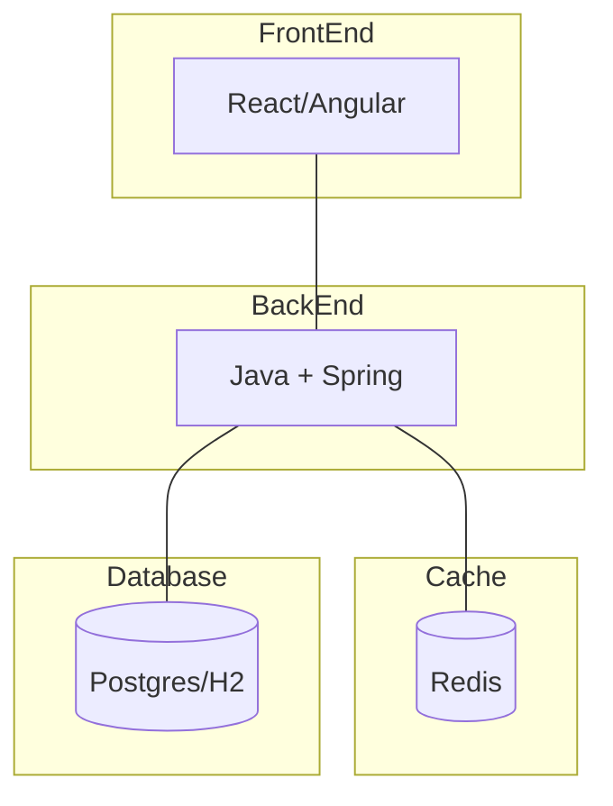
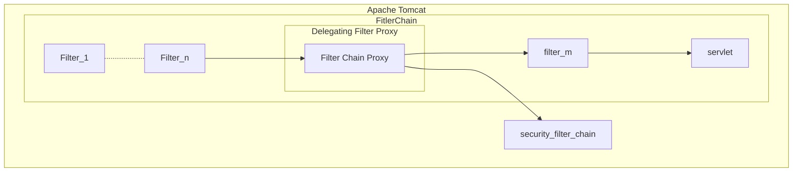
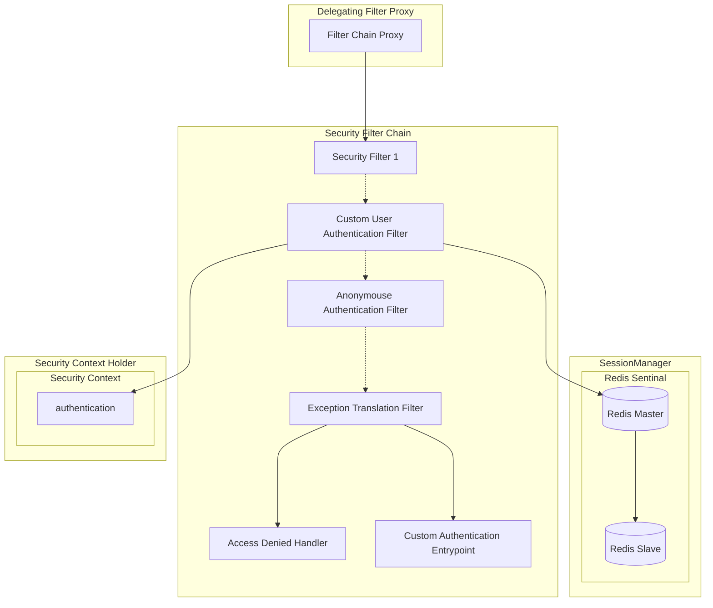
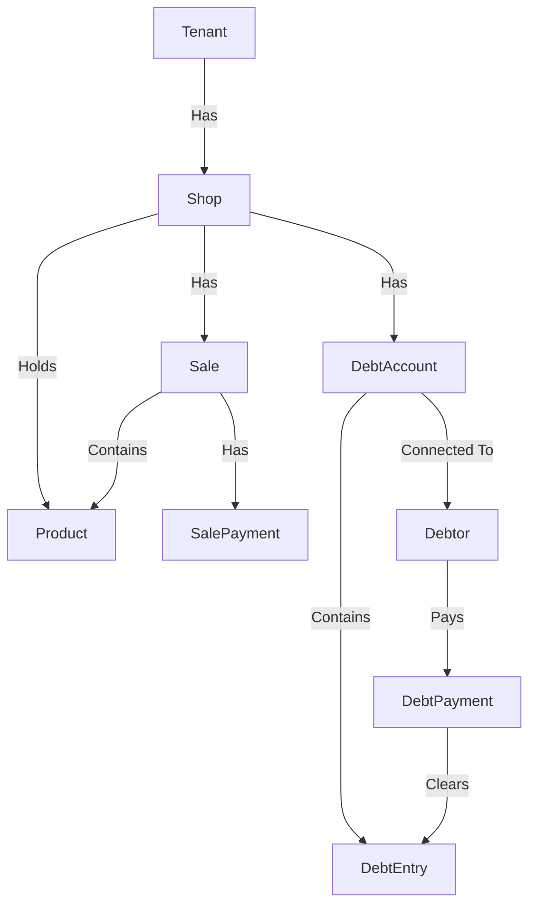

# RetailManager by LAR

---

This is a CRUD application for managing daily interactions of a retail shop.

The idea came from one of my freelance project of a similar kind which asked for a offline first desktop application for
managing the day-to-day interactions of one of the biggest reatil shops in the area.

Thie version manages

- Sales
- Prodcuts
- Stock
- Debts
- Payments

records.

## Design

---

### Highlevel

### Servlet Architecture

#### Security

#### API Design

